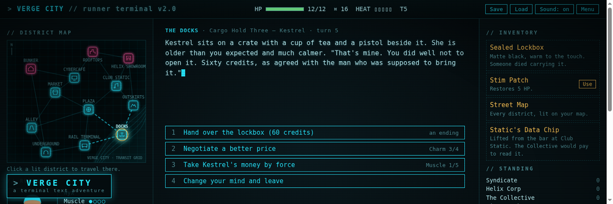

# Verge City — a terminal text adventure



**Play it:** <https://eoinfitzsimons.github.io/Eoin-s-Text-Game/>

Verge City is a browser-based, terminal-styled text adventure set over one rainy night in a cyberpunk city. A courier dies in front of you with a sealed case cuffed to his wrist. The Syndicate wants it delivered, Helix Corp wants it back, the Collective wants to know what is inside, and the City Watch would like a word with whoever is carrying it. You have twelve districts, a handful of credits and the stats you chose at the start. There are seven endings; some of them pay.

Everything on screen is drawn in code (canvas, inline SVG and CSS) and every sound is synthesised with the Web Audio API. There are no image or audio files in the repository apart from `thumbnail.png`, which is a screenshot of the game itself.

## How to play

1. Open the game and choose **New run**.
2. Name your runner, pick a look (the portrait is drawn live on a canvas) and spend five points across four stats:
   **Muscle** (fighting, forcing), **Reflex** (sneaking, running), **Tech** (hacking, rewiring) and **Charm** (talking).
3. Read the screen and pick a choice. Many choices show a requirement such as `Tech 2/3`: your current value against what is needed. Items in your pockets add to those values, so a Neon Blade makes you a better fighter and a Holo Cloak a better sneak. Some choices need a specific item, some need credits, and some are simply decisions.
4. Travel between districts from a district hub, either with the travel choices or by clicking a lit district on the map. Sealed districts (the Rooftops, the Helix Showroom and the Bunker) open with a key, a hack, or a change in the city's power.
5. Keep an eye on **Heat**. The more the City Watch notice you, the more likely you are to be stopped, fined or searched on the way somewhere.
6. Find an ending. Hand the case to Kestrel, sell it to Helix, give it to the Collective, broadcast it, destroy it, leave on the night train, or die trying.

### Controls

| Key | Action |
| --- | --- |
| `1` – `9` | Pick the numbered choice |
| `Space` / `Enter` / click the story | Skip the typewriter and show the full text |
| `S` | Save |
| `L` | Load |
| `M` | Toggle the synthesised sound |
| `Esc` | Back to the title screen (and back again) |

The game also saves itself after every choice, so **Continue** on the title screen picks up where you left off. Reaching an ending clears the save.

## Features

- **Original story** with 54 rooms across 12 districts, four factions whose standing shifts with your actions, a journal that records what you have learned, and seven endings.
- **Choices that matter.** Stat checks are deterministic and shown up front, so a specialist opens doors a generalist cannot. Items change outcomes: an EMP opens the Bunker or clears a Watch patrol, a Data Chip buys the truth from the Collective, a Rare Chip buys a Helix badge from a scavenger.
- **Character creator** with a procedurally drawn canvas portrait (hair, dye, eyewear, skin, jacket) and point-buy stats.
- **Canvas district map** with hand-placed districts, a river, transit edges, sealed districts in magenta and a pulsing marker for where you are. Lit neighbours are clickable.
- **Terminal aesthetic** built in CSS: phosphor palette, scanlines, vignette, a flicker, and a blinking block cursor.
- **Typewriter text** with a tick for every few characters and a skip key.
- **Synthesised sound**: typing ticks, item pickup, spending, damage, healing, success and failure cues, with a mute toggle that is remembered between visits.
- **Save and load** through `localStorage`, with autosave after every choice and a Continue button on the title screen.
- Keyboard-first controls and a responsive three-column layout that collapses on narrow screens.

## Running locally

The game is a static site with no build step and no dependencies. Serve the repository root with any static file server, for example:

```bash
python3 -m http.server 8000
```

Then open <http://localhost:8000/>. Opening `index.html` directly from disk also works in most browsers, though some block `localStorage` on `file://` URLs, in which case saving will be unavailable.

## Technical notes

| File | Purpose |
| --- | --- |
| `index.html` | Page structure: top bar, three-column layout, overlay for the title screen and character creator |
| `style.css` | Terminal styling, scanline and vignette layers, responsive grid |
| `game.js` | Engine: state, rendering, typewriter, travel and Watch patrols, save/load, keyboard input, title and creator screens, the `G` helper object that content handlers call |
| `content.js` | Data: stats, items, factions, districts, every room and every ending |
| `map.js` | Canvas drawing for the district map and the runner portrait |
| `audio.js` | Web Audio synthesis for every sound cue |
| `thumbnail.png` | 1080×360 in-game screenshot used by the portfolio site |

Rooms are plain objects with a `text` (string or function of state) and a `choices(state)` function returning `{ label, hint, when, do }` entries. Handlers call helpers such as `G.check("tech", 3)`, `G.give("badge")`, `G.damage(3, "a shock baton")` and `G.go("roomId", "result text")`; the engine renders the result text in amber above the next room's description. District hubs get travel choices generated from the map's edge list, so adding a district is a matter of a layout entry, an edge or two and a hub room.

State is a single serialisable object (player, flags, heat, factions, known and visited districts, journal), which is what makes save/load a `JSON.stringify` away. The AudioContext is created on the first user gesture so browsers do not block it.

British English spelling is used throughout the code, the interface and this document.

## Licence

MIT.
